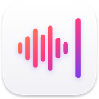

<p></p>

# Lowspeak

**Segure fn, fale, solte. Suas palavras já estão lá.**

O Lowspeak fica na sua barra de menus e só escuta enquanto você segura a tecla fn. Diga o que quer escrever, solte, e o texto aparece no app em que você estiver: e-mail, chat, editor de código, terminal.

É um app de Mac de verdade, escrito em Rust sobre AppKit, sem nenhum motor de navegador por baixo. Inicia na hora e não atrapalha. Ele chega a abrir a conexão enquanto você ainda está falando, por isso o texto online aparece cerca de 0,4 segundos depois que você solta a tecla.

Escolha entre doze modelos de reconhecimento de fala. Com a sua própria chave da Groq, a transcrição online não custa nada dentro da cota diária da Groq; o GPT Transcribe da OpenAI cuida das gravações difíceis. O Lowspeak fala direto com eles, sem conta e sem servidor próprio no meio do caminho.

Ou deixe tudo no seu Mac. O Whisper e o NVIDIA Parakeet funcionam offline, então sua voz nunca sai da máquina, e o Parakeet transforma 40 segundos de fala em texto em cerca de um terço de segundo. Se você trabalha online, um modelo local instalado entra em ação quando a rede cai, e nenhum ditado se perde.

O Lowspeak fala 35 idiomas. Ele aprende os nomes e termos que você usa, pode tirar os vícios de linguagem e ajeitar a gramática, e guarda seus dez últimos ditados no menu, caso você precise de algum de novo.

[](https://github.com/sventmueller/lowspeak/releases/latest/download/Lowspeak.dmg)

**[Baixar Lowspeak.dmg](https://github.com/sventmueller/lowspeak/releases/latest/download/Lowspeak.dmg)**: assinado e notarizado pela Apple, para macOS 14 ou posterior, em Apple Silicon e Intel.

**Encontrou um bug?** [Abra uma issue](https://github.com/sventmueller/lowspeak/issues/new/choose) ou escolha **Ajuda › Relatar um Problema…** no menu do Lowspeak: o formulário abre com a sua versão já preenchida. Se o Lowspeak for útil para você, uma [estrela no GitHub](https://github.com/sventmueller/lowspeak) ajuda outras pessoas a encontrá-lo.

[](https://www.rust-lang.org)
[](https://www.apple.com/macos/)

[](https://github.com/madsmtm/objc2)
[](https://github.com/ggml-org/whisper.cpp)
[](https://huggingface.co/FluidInference)


[](#licença)

[Bahasa Indonesia](../id/README.md) ·
[Bahasa Melayu](../ms/README.md) ·
[Català](../ca/README.md) ·
[Čeština](../cs/README.md) ·
[Dansk](../da/README.md) ·
[Deutsch](../de/README.md) ·
[English](../../../README.md) ·
[Español](../es/README.md) ·
[Français](../fr/README.md) ·
[Hrvatski](../hr/README.md) ·
[Italiano](../it/README.md) ·
[Magyar](../hu/README.md) ·
[Nederlands](../nl/README.md) ·
[Norsk](../no/README.md) ·
[Polski](../pl/README.md) ·
**Português (Brasil)** ·
[Português (Portugal)](../pt_PT/README.md) ·
[Română](../ro/README.md) ·
[Slovenčina](../sk/README.md) ·
[Slovenščina](../sl/README.md) ·
[Suomi](../fi/README.md) ·
[Svenska](../sv/README.md) ·
[Tiếng Việt](../vi/README.md) ·
[Türkçe](../tr/README.md) ·
[Ελληνικά](../el/README.md) ·
[Русский](../ru/README.md) ·
[Українська](../uk/README.md) ·
[עברית](../he/README.md)‎ ·
[العربية](../ar/README.md)‎ ·
[हिन्दी](../hi/README.md) ·
[ไทย](../th/README.md) ·
[한국어](../ko/README.md) ·
[日本語](../ja/README.md) ·
[简体中文](../zh-Hans/README.md) ·
[繁體中文](../zh-Hant/README.md)

## Conteúdo

- [Recursos em resumo](#recursos-em-resumo)
- [Requisitos](#requisitos)
- [Instalação](#instalação)
- [Primeiros passos](#primeiros-passos)
  - [Permissões](#permissões)
  - [Escolha como transcrever](#escolha-como-transcrever)
  - [O menu](#o-menu)
  - [Referência rápida](#referência-rápida)
- [Como ditar](#como-ditar)
  - [Segure para falar](#segure-para-falar)
  - [Travar com Shift ou pressionando duas vezes](#travar-com-shift-ou-pressionando-duas-vezes)
  - [Para onde vai o texto](#para-onde-vai-o-texto)
  - [Ditados recentes](#ditados-recentes)
- [Transcrição](#transcrição)
  - [Qual modelo é o certo para você](#qual-modelo-é-o-certo-para-você)
  - [Online: OpenAI e Groq](#online-openai-e-groq)
  - [No seu Mac: Whisper e Parakeet](#no-seu-mac-whisper-e-parakeet)
  - [Quando o serviço online falha](#quando-o-serviço-online-falha)
  - [Como a gravação é preparada](#como-a-gravação-é-preparada)
  - [Idiomas por modelo](#idiomas-por-modelo)
  - [Macs com Intel](#macs-com-intel)
- [Vocabulário](#vocabulário)
- [Pós-processamento](#pós-processamento)
- [Microfone](#microfone)
- [Chaves de API](#chaves-de-api)
- [Notificações](#notificações)
- [Aparência e acessibilidade](#aparência-e-acessibilidade)
- [Idiomas](#idiomas)
- [Teclas e gestos](#teclas-e-gestos)
- [Privacidade e segurança](#privacidade-e-segurança)
- [Velocidade](#velocidade)
- [Limitações conhecidas](#limitações-conhecidas)
- [Solução de problemas](#solução-de-problemas)
- [Para desenvolvedores](#para-desenvolvedores)
  - [Componentes de terceiros](#componentes-de-terceiros)
- [Licença](#licença)

## Recursos em resumo

- **Nativo até a raiz.** Um item de verdade na barra de menus, com um menu AppKit, alertas e notificações padrão. Sem Electron, sem janela, sem ícone no Dock.
- **O modelo certo para cada tarefa.** A Groq para velocidade sem usar a memória do seu Mac, o GPT Transcribe da OpenAI para o melhor resultado, o Whisper ou o NVIDIA Parakeet no seu Mac para trabalhar offline e manter sua voz privada. Troque com um clique.
- **Privado.** Sem conta, sem telemetria. O áudio vai só para o provedor que você escolheu, ou para lugar nenhum no modo local.
- **Nenhum ditado perdido.** Quando a rede ou o serviço online falha, um modelo local instalado transcreve a mesma gravação no seu Mac.
- **No seu idioma.** O ditado funciona em dezenas de idiomas, e o menu, as caixas de diálogo e as notificações estão disponíveis em 35.
- **Suas palavras, escritas do jeito certo.** Um vocabulário de nomes e termos técnicos orienta a OpenAI, a Groq, o Whisper e o pós-processamento.
- **Texto limpo, se você quiser.** O pós-processamento opcional remove vícios de linguagem, corrige a gramática e, quando você se corrige, mantém só a correção, ou também formata o texto para o tipo de app em que você está ditando.
- **Sua área de transferência continua sua.** O Lowspeak cola pela área de transferência e, um instante depois, devolve o que estava nela. Os dez últimos ditados ficam no menu para você copiar de novo.
- **Segure fn, fale, solte.** O texto é digitado no app em primeiro plano, onde quer que esteja o cursor: e-mail, chat, editor, terminal ou navegador. Nenhuma janela para onde alternar, nenhum botão para clicar.
- **Trave para textos mais longos.** Pressione Shift enquanto segura fn, ou pressione fn duas vezes, e a gravação continua sem nenhuma tecla pressionada, por até cinco minutos. Um toque em fn ou Shift a encerra.
- **Continue falando.** Comece o próximo ditado enquanto o anterior ainda está sendo transcrito; os textos chegam na ordem em que você os falou.

## Requisitos

- macOS 14 Sonoma ou posterior. O Lowspeak é desenvolvido e testado no macOS 27.
- Um Mac com Apple Silicon ou processador Intel. A transcrição local foi feita para Apple Silicon, onde o Whisper roda na GPU e o Parakeet no Neural Engine; em Macs com Intel, os dois rodam no processador, muito mais devagar, veja [Macs com Intel](#macs-com-intel).
- Cerca de 17 MB para o app, mais 75 MB a 3 GB para cada modelo local que você baixar.
- Para a transcrição online, uma chave de API da [OpenAI](https://platform.openai.com/api-keys) ou da [Groq](https://console.groq.com/keys). A OpenAI cobra pelo que você transcreve; o plano gratuito da Groq não custa nada dentro dos limites diários do plano, que aparecem no console da Groq. A transcrição local não precisa de conta.

## Instalação

**Pela imagem de disco.** Baixe [`Lowspeak.dmg`](https://github.com/sventmueller/lowspeak/releases/latest/download/Lowspeak.dmg), abra-o e arraste o Lowspeak para a pasta Aplicativos. A imagem é assinada com um Developer ID e notarizada pela Apple, então abre sem avisos.

**Com o Homebrew.** O cask fica em um tap próprio:

```sh
brew install --cask sventmueller/tap/lowspeak
```

`brew uninstall --zap --cask lowspeak` também remove os ajustes, os modelos, os registros e os caches do Lowspeak; suas chaves de API continuam nas Chaves de início de sessão.

**Atualizações.** O Lowspeak instalado pela imagem de disco ou pelo Homebrew se mantém atualizado com o [Sparkle](https://sparkle-project.org). Na segunda abertura, ele pergunta se pode buscar atualizações por conta própria, uma vez por dia. **Buscar Atualizações…** no menu busca na hora; **Buscar Atualizações Automaticamente** e **Baixar e Instalar Atualizações Automaticamente**, logo abaixo, mudam sua escolha depois. Quando uma busca encontra uma nova versão enquanto você trabalha em outro app, aparece um ponto no anel da barra de menus, e **Buscar Atualizações…** traz a atualização para o primeiro plano. O Lowspeak só instala uma atualização se ela tiver a assinatura do desenvolvedor; seus ajustes, chaves e modelos são mantidos. `brew upgrade --cask lowspeak` também atualiza uma cópia instalada pelo Homebrew. A versão 1.0.0 não tem atualizador: instale uma vez uma versão mais nova por cima dela, pela [página de releases](https://github.com/sventmueller/lowspeak/releases). Uma versão compilada por você também não tem atualizador.

**Pelo código-fonte.** Veja [Compilação e implantação](../../../docs/development.md#build--deploy) para os pré-requisitos e depois:

```sh
make deploy
```

Isso compila o Lowspeak, substitui a cópia na sua pasta Aplicativos e o abre.

**Abrir no Início da Sessão** no menu inicia o Lowspeak junto com o Mac, pelos próprios itens de início do macOS. Só uma cópia roda por vez; uma segunda é encerrada na hora.

## Primeiros passos

### Permissões

Na primeira abertura, o Lowspeak pede três permissões:

- **Acessibilidade** (Ajustes do Sistema › Privacidade e Segurança › Acessibilidade; no macOS 27 a lista se chama Controle do Dispositivo e Acesso a Dados). O Lowspeak precisa dela para perceber a tecla fn e para colar com ⌘V. O macOS oferece abrir a lista; ative o botão ao lado do Lowspeak. As mensagens do próprio Lowspeak chamam a lista pelo nome que o seu macOS mostra.
- **Microfone.** Pedida uma única vez; sem ela, o Lowspeak não grava nada.
- **Notificações.** O Lowspeak as usa para problemas que você não veria de outra forma, como um microfone mudo ou uma transcrição que falhou.

### Escolha como transcrever

Configure pelo menos uma forma; você pode trocar a qualquer momento no menu.

- **Online:** escolha **Definir Chave de API…** e cole uma chave da OpenAI (começa com `sk-`) ou da Groq (`gsk_`). O Lowspeak reconhece o provedor pela chave. Depois escolha um modelo em **OpenAI** ou **Groq**.
- **No seu Mac:** escolha **Gerenciar Modelos** › **Baixar Parakeet Ultra** ou um modelo Whisper e depois selecione-o em **Local**.

[Qual modelo é o certo para você](#qual-modelo-é-o-certo-para-você) ajuda na escolha. Depois segure fn, diga alguma coisa e solte.

### O menu

Clique no anel na barra de menus:

| Item | O que faz |
|---|---|
| **Ditados Recentes** | os dez últimos textos; um clique copia um deles de novo para a área de transferência |
| **Local** | os modelos no seu Mac, agrupados em Whisper e Parakeet; os que não foram baixados ficam esmaecidos |
| **OpenAI**, **Groq** | os modelos online; sem chave, ficam esmaecidos e o menu oferece **Definir Chave de API…** |
| **Idioma** | o idioma em que você dita, ou **Detecção Automática**; o menu acompanha |
| **Pós-Processamento** | **Desativado**, **Limpeza** ou **Formatação**, veja [Pós-processamento](#pós-processamento) |
| **Vocabulário…** | nomes e termos que devem ser escritos exatamente assim; o menu mostra quantos você inseriu |
| **Microfone** | **Padrão do Sistema** ou um microfone fixo, e **Tocar Som ao Ficar Pronto** |
| **Gerenciar Modelos** | baixar e apagar modelos locais, com indicação de progresso |
| **Definir Chave de API…** / **Atualizar Chave de API…** | adicionar, substituir ou remover chaves |
| **Abrir no Início da Sessão** | iniciar o Lowspeak junto com o Mac; a marca de seleção indica que está ativado |
| **Buscar Atualizações…** | buscar uma nova versão agora; os dois itens abaixo dele decidem se o Lowspeak busca uma vez por dia e instala atualizações sem perguntar. Só no app da imagem de disco |
| **Ajuda** | **Referência Rápida**, **Relatar um Problema…**, **Sugerir um Recurso…**, **Lowspeak no GitHub** |
| **Sobre o Lowspeak** | versão, copyright, página do projeto e licença |
| **Encerrar Lowspeak** | ⌘Q com o menu aberto |

A marca de seleção em **Local**, **OpenAI** e **Groq** indica o modelo em uso. O ícone mostra o que o Lowspeak está fazendo:

| Ícone | Significado |
|---|---|
| Anel com um ponto | Pronto |
| Círculo preenchido | Gravando enquanto fn está pressionada |
| Quadrado arredondado | Gravação travada; o próximo toque em fn ou Shift a encerra |
| Anel piscando | Transcrevendo |
| Anel com um ponto no canto superior direito | Uma nova versão está esperando, veja **Buscar Atualizações…** |
| ↓ 42% | Baixando um modelo |

O Lowspeak não tem janela de ajustes: tudo está neste menu, e ele lembra cada escolha.

### Referência rápida

**Ajuda › Referência Rápida** mostra os gestos de fn em uma pequena janela, no seu idioma, com um botão que abre os ajustes de teclado. **Relatar um Problema…** abre um formulário no GitHub com as versões do Lowspeak e do macOS já preenchidas, **Sugerir um Recurso…** abre uma discussão para ideias, e **Lowspeak no GitHub**, a página do projeto.

## Como ditar

### Segure para falar

Segure fn, fale, solte. O ícone de gravação aparece no momento em que o microfone começa a captar som; comece a falar nessa hora, porque o que você diz antes não é gravado. Soltar fn encerra a gravação, e o texto vem um instante depois.

Um toque rápido em fn não faz nada, então fn continua com suas outras funções. Uma gravação que fica vazia ou dura menos de 0,3 segundos é descartada.

### Travar com Shift ou pressionando duas vezes

Para textos mais longos, trave a gravação para que ela continue sem nenhuma tecla pressionada. Há três formas:

- **Shift enquanto segura fn.** Comece com fn como de costume e pressione Shift durante a gravação: ela trava, e você pode soltar fn. Nada do que você disse antes se perde; a gravação simplesmente continua.
- **Shift, depois fn.** Segure Shift e pressione fn: a gravação já começa travada.
- **fn duas vezes.** Toque em fn rapidamente (menos de 0,3 segundos) e pressione de novo em até 0,4 segundos. A gravação vale desde o primeiro toque.

O ícone vira um quadrado arredondado. Pressione **fn** ou **Shift** uma vez para parar; o texto vem como de costume. Se a sua tecla 🌐 estiver configurada para abrir Emoji e Símbolos, pare com Shift: um toque rápido em fn abriria o visualizador.

Uma gravação para sozinha depois de dois minutos com fn pressionada e depois de cinco minutos quando travada, e então é transcrita como de costume.

### Para onde vai o texto

O Lowspeak cola o texto no app que estava em primeiro plano quando você parou de falar, na posição do cursor, pela área de transferência e ⌘V. Ele guarda tudo o que estava antes na área de transferência e devolve meio segundo depois que o app lê o texto, ou após dez segundos se isso nunca acontecer, a menos que outro app tenha alterado a área de transferência nesse meio-tempo. O texto é marcado como transitório, então apps de histórico da área de transferência que respeitam essa marcação não o registram.

Você pode começar o próximo ditado enquanto o anterior ainda está sendo transcrito. Os textos são colados na ordem em que você os falou, e nunca enquanto você está gravando ou segurando Shift, para que uma colagem não caia no meio da sua próxima frase.

Sem a permissão de Acessibilidade, ou quando o ⌘V simulado não pode ser enviado, o texto fica na área de transferência e uma notificação avisa; cole você mesmo com ⌘V.

### Ditados recentes

**Ditados Recentes** no menu lista os dez últimos textos, do mais novo para o mais antigo, cada um encurtado para uma linha; passar o ponteiro por cima mostra o texto inteiro. Um clique copia o texto para a área de transferência, para quando ele foi parar no lugar errado ou você precisa dele duas vezes. A lista existe só na memória e fica vazia depois que o Lowspeak é encerrado.

## Transcrição

### Qual modelo é o certo para você

| Você quer | Escolha | Por quê |
|---|---|---|
| **Velocidade sem sobrecarregar o Mac** | **Groq › Whisper Large V3 Turbo** | a opção online mais rápida; nada é baixado, e o Mac mantém sua memória e seu espaço em disco |
| **O melhor resultado** | **OpenAI › GPT Transcribe** (padrão) | o mais preciso dos modelos que o Lowspeak oferece; recebe seu vocabulário como palavras-chave |
| **Offline e privado** | **Local › Parakeet Ultra** para idiomas europeus, **Local › Whisper Large v3 Turbo** para todos os outros | funciona sem rede, e sua voz nunca sai do Mac; o Parakeet é o mais rápido de todos |
| **Sem conta, sem custos** | qualquer modelo **Local** | roda no seu Mac; nada é cobrado |
| **Online, mas de graça** | **Groq**, no plano gratuito | uma conta na Groq sem forma de pagamento; a transcrição não custa nada dentro dos limites diários da Groq |
| **Confiabilidade e velocidade ao mesmo tempo** | um modelo online, mais o Parakeet Ultra ou um modelo Whisper instalado | o modelo local entra em ação quando o serviço online falha |
| **Um Mac com Intel** | **Groq** ou **OpenAI** | lá os modelos locais rodam no processador, veja [Macs com Intel](#macs-com-intel) |

Os modelos locais ocupam no disco o tamanho do download e, enquanto estão selecionados, mais ou menos o mesmo de memória; o Lowspeak mantém o modelo carregado para que o ditado comece sem demora. Em um Mac com 8 GB de memória, prefira o Parakeet Ultra ou um modelo online aos modelos Whisper grandes.

### Online: OpenAI e Groq

| Modelo | Provedor | Observações |
|---|---|---|
| **GPT Transcribe** (padrão) | OpenAI | o mais preciso; recebe seu vocabulário como palavras-chave |
| **Whisper** | OpenAI | o modelo Whisper original |
| **Whisper Large V3** | Groq | muito rápido |
| **Whisper Large V3 Turbo** | Groq | o mais rápido online |

A gravação é compactada em AAC antes do envio, cerca de 6 KB por segundo de fala, então o ditado funciona também em conexões lentas. Enquanto você segura fn, o Lowspeak já abre a conexão com o provedor, para que o envio comece no instante em que você solta.

### No seu Mac: Whisper e Parakeet

| Modelo | Tamanho | Roda em | Idiomas |
|---|---|---|---|
| **Parakeet Ultra** | ~630 MB | Neural Engine | 25 idiomas europeus |
| **Parakeet v2** | ~600 MB | Neural Engine | inglês |
| **Whisper Large v3 Turbo** | ~1,6 GB | GPU (Metal) | cerca de 99 |
| **Whisper Large v3** | ~3 GB | GPU (Metal) | cerca de 99 |
| **Whisper Medium** | ~1,5 GB | GPU (Metal) | cerca de 99 |
| **Whisper Small** | ~470 MB | GPU (Metal) | cerca de 99 |
| **Whisper Base** | ~150 MB | GPU (Metal) | cerca de 99 |
| **Whisper Tiny** | ~75 MB | GPU (Metal) | cerca de 99 |

**Gerenciar Modelos** baixa e apaga os modelos; durante um download, a barra de menus mostra o progresso, e encerrar o Lowspeak o cancela. O primeiríssimo uso de um modelo o prepara para o seu Mac: cerca de 10 segundos para o Parakeet Ultra, até 30 segundos para o Whisper; depois disso, ele carrega em uma fração de segundo. Se o modelo que você escolheu for apagado, o Lowspeak passa para outro instalado.

O **Parakeet** é a opção mais rápida: transcreve 40 segundos de fala em cerca de 0,3 segundos. O Lowspeak o executa com os mesmos modelos e a mesma decodificação do [FluidAudio](https://github.com/FluidInference/FluidAudio) e os guarda na pasta do FluidAudio (`~/Library/Application Support/FluidAudio/Models`), para que os apps baseados no FluidAudio os compartilhem. Gravações com mais de 15 segundos são transcritas em janelas sobrepostas, unidas sem perder palavras nas emendas. O **Whisper** entende mais idiomas e lê seu vocabulário; os modelos grandes são os mais precisos, e os pequenos, bem mais fracos fora do inglês. Os modelos Whisper ficam em `~/Library/Application Support/Lowspeak/Models`.

### Quando o serviço online falha

Se uma transcrição online falhar, porque a rede caiu, o provedor está com problemas ou a chave está errada, um modelo local instalado transcreve a mesma gravação: o escolhido em **Local**, senão o Parakeet Ultra, depois o Whisper Large v3 Turbo, o Large v3 e os modelos Whisper menores, com o Parakeet v2 por último. Uma notificação avisa você uma vez; ela só volta depois que um ditado online tiver dado certo nesse meio-tempo.

Com um modelo local de reserva, o Lowspeak dá 20 segundos à solicitação online; sem ele, tenta três vezes, por até um minuto cada. No modo online, o Lowspeak prepara o modelo Parakeet de reserva uma vez ao abrir, para que a primeira substituição não precise esperar por ele.

### Como a gravação é preparada

O Lowspeak grava na taxa de amostragem própria do seu microfone e, assim que você para, converte para os 16 kHz que os modelos esperam. Antes da transcrição, ele remove o ruído grave abaixo de 80 Hz, corta o silêncio no início e no fim e nivela o volume, para que vozes baixas e altas saiam iguais. Uma gravação sem fala nem chega a ser enviada. No modo local, o Parakeet recebe primeiro a gravação intacta e só recebe a preparada se aquela não render texto.

### Idiomas por modelo

O idioma escolhido em **Idioma** é passado aos modelos online e ao Whisper. Com **Detecção Automática**, o modelo descobre o idioma sozinho.

| Modelo | Idiomas em que você pode ditar |
|---|---|
| GPT Transcribe, Whisper (OpenAI, Groq, no seu Mac) | cerca de 99, entre eles todos os 35 do menu |
| Parakeet Ultra | alemão, búlgaro, croata, dinamarquês, eslovaco, esloveno, espanhol, estoniano, finlandês, francês, grego, holandês, húngaro, inglês, italiano, letão, lituano, maltês, polonês, português, romeno, russo, sueco, tcheco, ucraniano |
| Parakeet v2 | inglês |

O Parakeet detecta o idioma sozinho e ignora a escolha no menu. **Chinês (tradicional)** faz o GPT Transcribe escrever em caracteres tradicionais; o Whisper escreve chinês em qualquer uma das duas escritas e português sem levar em conta a variante.

### Macs com Intel

O Lowspeak é um app universal e também roda em Macs com Intel com macOS 14. Tudo o que é online funciona do mesmo jeito. Lá, porém, os modelos locais não têm o hardware para o qual foram feitos: o Whisper roda no processador em vez da GPU, e o Parakeet no processador em vez do Neural Engine. Os dois funcionam, mas levam muitas vezes mais tempo do que no Apple Silicon, e os modelos Whisper grandes, tempo demais para ditado. Em um Mac com Intel, transcreva online e mantenha o Whisper Small ou o Parakeet Ultra como [reserva](#quando-o-serviço-online-falha).

## Vocabulário

**Vocabulário…** recebe os nomes e termos que o Lowspeak deve escrever exatamente assim, separados por vírgulas: nomes de produtos, colegas, termos técnicos. Até 100 termos de até 60 caracteres cada; `<` e `>` são removidos.

- O **GPT Transcribe** os recebe como palavras-chave.
- O **Whisper** (OpenAI, Groq e no seu Mac) os lê como uma dica antes da gravação, até 500 caracteres.
- O **pós-processamento** é instruído a escrevê-los exatamente como foram escritos.
- O **Parakeet** não os usa.

## Pós-processamento

Depois da transcrição, um modelo de linguagem pode retrabalhar o texto. Escolha em **Pós-Processamento**:

- **Desativado** (padrão) — o texto como foi transcrito.
- **Limpeza** — remove vícios de linguagem como “hã”, “tipo” ou “basicamente”, corrige gramática e pontuação e, quando você se corrige, mantém só a correção. Não acrescenta nada e não muda o sentido.
- **Formatação** — como Limpeza, e ainda adapta o texto ao app em que você está ditando: termos no estilo de código em editores de código, linhas de comando em terminais, um tom descontraído em apps de chat, um tom profissional em e-mails.

O pós-processamento usa a Groq (`openai/gpt-oss-120b`) se você tiver uma chave da Groq, senão a OpenAI (`gpt-4o-mini`), também quando você transcreve localmente. Com um idioma escolhido em **Idioma**, ele mantém esse idioma. Se demorar mais de oito segundos, falhar ou devolver uma resposta cortada ou muito mais longa do que aquilo que você disse, o Lowspeak cola o texto sem processamento. Se o provedor recusar a solicitação ou nenhuma chave estiver definida, uma notificação avisa uma vez.

## Microfone

Em **Microfone**, escolha um microfone fixo ou **Padrão do Sistema**. O Lowspeak lembra o dispositivo; enquanto ele não estiver conectado, o menu o mostra como **(não conectado)** e o Lowspeak grava com o padrão do sistema.

O microfone só é ligado enquanto você dita. Deixá-lo pronto leva cerca de 0,07 segundos com o microfone embutido, cerca de meio segundo com um Studio Display e de um a dois segundos com AirPods, que antes passam para o modo headset. O ícone de gravação aparece assim que o som chega; **Tocar Som ao Ficar Pronto** acrescenta um som curto nesse momento. Ele vem desativado por padrão, porque em alguns alto-falantes o próprio som chega meio segundo atrasado.

Se um microfone captar só silêncio por cinco segundos, como acontece com os AirPods quando outro dispositivo está usando o microfone deles, o Lowspeak avisa.

## Chaves de API

**Definir Chave de API…** pede uma chave e reconhece o provedor pelo começo dela: `sk-` para a OpenAI, `gsk_` para a Groq. Uma chave em outro formato é recusada com uma explicação. Insira uma chave por provedor; com chaves dos dois, todos os modelos online ficam disponíveis. **Atualizar Chave de API…** substitui uma chave ou, com **Remover Todas as Chaves**, apaga todas.

As chaves ficam guardadas nas suas Chaves de início de sessão, sob `com.lowspeak.app`. Um arquivo de chaves de uma versão anterior (`~/Library/Application Support/Lowspeak/.api-key`) é movido para lá na próxima abertura e apagado assim que todas as chaves puderem ser lidas de novo a partir das Chaves.

## Notificações

O Lowspeak trabalha em segundo plano, por isso informa os problemas por notificações:

| Notificação | O que aconteceu |
|---|---|
| **Falha na Gravação** | sem acesso ao microfone, nenhum microfone conectado, ou o microfone não pôde ser iniciado |
| **Microfone sem Sinal** | cinco segundos de silêncio, veja [Microfone](#microfone) |
| **Permissão de Acessibilidade Necessária** | o texto está na área de transferência; permita o acesso em Acessibilidade para colar automaticamente |
| **Falha ao Colar** | o texto está na área de transferência; cole com ⌘V |
| **Falha na Transcrição** | com o motivo: sem chave, chave recusada, limite de solicitações, erro de servidor ou de rede, ou nenhum modelo local |
| **Transcrito neste Mac** | o serviço online falhou e um modelo local assumiu |
| **Falha no Pós-Processamento** | o provedor recusa o pós-processamento ou nenhuma chave está definida; o texto foi colado sem ele |
| **Nenhuma Chave de API** | você escolheu um modelo online sem chave para o provedor dele |
| **Falha no Download**, **Falha ao Apagar**, **Não É Possível Apagar** | o gerenciamento de um modelo local não funcionou, ou outra operação ainda estava em andamento |
| **Erro no Item de Início**, **Erro na Chave de API** | o macOS ou as Chaves recusaram a alteração |

As notificações nunca contêm o texto que você ditou. Um serviço online com falha e um provedor de pós-processamento que recusa as solicitações são informados uma vez, não a cada ditado, até voltarem a funcionar.

## Aparência e acessibilidade

- **O ícone da barra de menus** é uma imagem modelo que acompanha uma barra de menus clara, escura ou colorida.
- O **VoiceOver** lê o ícone como “Lowspeak”, e o menu, os alertas e as notificações são controles padrão do macOS.
- **Nenhuma tecla precisa ficar pressionada.** Trave uma gravação com Shift ou pressionando fn duas vezes, e o próximo toque a encerra.
- **A Referência Rápida** é uma janela simples com rótulos e um botão, acessível pelo teclado; Esc a fecha.

As lacunas conhecidas estão listadas em [ACCESSIBILITY.md](../../../ACCESSIBILITY.md): o VoiceOver não anuncia quando uma gravação começa, e o Lowspeak ainda não foi verificado com o VoiceOver nem com o Controle Assistivo.

## Idiomas

O menu, as caixas de diálogo e as notificações estão traduzidos para 35 idiomas:

Alemão, árabe, catalão, chinês (simplificado), chinês (tradicional), coreano, croata, dinamarquês, eslovaco, esloveno, espanhol, finlandês, francês, grego, hebraico, hindi, holandês, húngaro, indonésio, inglês, italiano, japonês, malaio, norueguês, polonês, português (Brasil), português (Portugal), romeno, russo, sueco, tailandês, tcheco, turco, ucraniano e vietnamita.

O idioma que você escolhe em **Idioma** é também o idioma do menu. Com **Detecção Automática**, o menu segue a ordem de idiomas em **Ajustes do Sistema › Geral › Idioma e Região**, e usa o inglês quando não há tradução. Os termos de menu seguem as traduções da própria Apple, de modo que o Lowspeak se lê como o resto do seu Mac. Exceto o inglês, as traduções foram feitas por máquina e ainda não foram revisadas por falantes nativos; correções são bem-vindas como [issues](https://github.com/sventmueller/lowspeak/issues/new/choose).

## Teclas e gestos

| Ação | Teclas |
|---|---|
| Ditar enquanto segura | segure fn |
| Travar uma gravação em andamento | Shift enquanto segura fn |
| Começar uma gravação travada | Shift+fn, ou fn duas vezes rapidamente |
| Encerrar uma gravação travada | fn ou Shift |
| Encerrar o Lowspeak (menu aberto) | ⌘Q |
| Fechar a Referência Rápida | Esc |

O Lowspeak impede que os toques em fn que ele usa cheguem a outros apps; o Shift passa normalmente.

## Privacidade e segurança

O Lowspeak ouve o que você diz enquanto fn está pressionada, pode digitar em qualquer app e guarda suas chaves de API, por isso faz o mínimo possível com tudo isso.

- **Sua voz vai para um só lugar.** No modo online, a gravação, compactada, vai para o provedor que você escolheu, OpenAI ou Groq, junto com seu vocabulário. No modo local, nada sai do seu Mac. Quando uma solicitação online falha, um modelo local transcreve a mesma gravação no seu Mac.
- **O pós-processamento**, se você o ativar, envia o texto transcrito e seu vocabulário para a Groq ou a OpenAI. No modo Formatação, ele acrescenta o tipo de app em que você está ditando (editor de código, terminal, chat ou e-mail); o nome do app não é enviado.
- **Sem telemetria, sem conta.** Além da transcrição e do pós-processamento, o Lowspeak só se conecta à internet para abrir a conexão com o seu provedor enquanto fn está pressionada, no modo online ou com o pós-processamento ativado, para baixar um modelo quando você pede, do Hugging Face via HTTPS, em uma versão fixa e conferindo a soma de verificação de cada arquivo, e para buscar uma nova versão no GitHub, uma vez por dia se você permitir. Essa requisição leva a versão do Lowspeak e nada mais. **Ajuda › Relatar um Problema…** abre um formulário do GitHub no seu navegador; o endereço leva a versão do Lowspeak e a do macOS, nada do que você ditou.
- **As chaves de API** ficam nas suas Chaves de início de sessão. Elas são enviadas apenas ao próprio provedor e removidas das mensagens de erro antes que qualquer coisa seja gravada no registro.
- **O texto ditado não é armazenado.** Os dez últimos ditados ficam na memória para **Ditados Recentes** e somem quando o Lowspeak é encerrado. Os arquivos de registro anotam tamanhos e tempos, nunca o texto.
- **A área de transferência** é salva antes de colar e restaurada assim que o app lê o texto, a menos que outro app a tenha alterado nesse meio-tempo. O ditado é marcado como transitório, então apps de histórico da área de transferência que respeitam essa marcação o ignoram.
- **Assinatura de código** com o Hardened Runtime; o app pede acesso apenas ao microfone, à Acessibilidade, às notificações e à rede. Uma atualização precisa ter a assinatura do desenvolvedor, senão o Sparkle a recusa.

Para relatar uma vulnerabilidade, siga a [política de segurança](../../../SECURITY.md).

## Velocidade

Medido em Apple Silicon:

- O **Parakeet Ultra** transcreve 40 segundos de fala em cerca de 0,3 segundos.
- **Online:** a primeira solicitação depois de uma pausa leva cerca de 0,4 segundos na Groq, porque o Lowspeak abre a conexão enquanto você ainda está falando; as solicitações seguintes a reutilizam, via HTTP/3 quando o provedor oferece.
- **Tamanho do envio:** cerca de 6 KB por segundo de fala, em AAC a 48 kbit/s.
- **Deixar o microfone pronto:** cerca de 0,07 segundos no embutido, meio segundo em um Studio Display, de um a dois segundos com AirPods.

## Limitações conhecidas

- **Modelos locais em Macs com Intel** rodam no processador e são muito mais lentos; lá, a transcrição online é a melhor escolha.
- **O que você diz antes de o microfone ficar pronto se perde.** Espere o ícone de gravação, principalmente com AirPods.
- **Outros podem tomar a tecla fn.** Quando o ajuste da tecla 🌐 do macOS, o Warp ou o Ditado do macOS capturam fn primeiro, o Lowspeak não a vê; veja [Solução de problemas](#solução-de-problemas).
- O **Parakeet** ignora o vocabulário e a escolha de idioma, e só conhece idiomas europeus.
- **Escrita e variante:** só o GPT Transcribe pode ser instruído a escrever em chinês tradicional; nenhum modelo pode ser instruído a escrever em português europeu em vez de brasileiro.
- **Limites de tempo:** dois minutos com fn pressionada, cinco minutos quando travada.
- **Modo de Microfone:** a Central de Controle oferece Isolamento de Voz e Espectro Amplo para o Lowspeak e os mostra como ativos, mas o Lowspeak grava sem processamento de voz, então a escolha não tem efeito.
- **Ditados Recentes** existem só na memória e somem depois que o app é encerrado.
- **Por escolha de projeto:** sem janela de ajustes, sem ícone no Dock, fora da App Store.

## Solução de problemas

**Nada acontece quando seguro fn.** Verifique três coisas: o Lowspeak está permitido em **Ajustes do Sistema › Privacidade e Segurança › Acessibilidade** (no macOS 27: **Controle do Dispositivo e Acesso a Dados**); **Ajustes do Sistema › Teclado › Pressionar a tecla 🌐 para** está definido como **Não Fazer Nada**; e nenhum outro app captura fn. O Warp faz isso por padrão; desative com `defaults write dev.warp.Warp-Stable VoiceInputToggleKey '""'` e reinicie o Warp. O Ditado do macOS também pode estar configurado para começar com fn.

**Depois de uma atualização, o Lowspeak não reage mais a fn.** O macOS associa a permissão de Acessibilidade à assinatura do app. Se a assinatura mudou, por exemplo de uma compilação feita por você para o app baixado, remova o Lowspeak da lista de Acessibilidade (no macOS 27: Controle do Dispositivo e Acesso a Dados) e adicione-o de novo.

**As primeiras palavras somem.** Comece a falar quando o ícone de gravação aparecer. Com AirPods, o microfone precisa de um a dois segundos; um microfone embutido ou USB escolhido em **Microfone** fica pronto quase na hora.

**“Microfone sem Sinal.”** O microfone não captou som por cinco segundos. Com AirPods, outro dispositivo pode estar usando o microfone deles; mude para o microfone embutido ou reconecte-os. A tampa fechada de um MacBook também silencia o microfone embutido.

**Os ditados saem vazios.** O volume de entrada pode estar baixo demais: apps como Teams, Zoom ou Meet o alteram durante chamadas, e o macOS o guarda por dispositivo. Aumente-o em **Ajustes do Sistema › Som › Entrada**.

**O texto foi parar no lugar errado.** **Ditados Recentes** no menu o copia de novo para a área de transferência.

**“Nenhuma Chave de API.”** Escolha **Definir Chave de API…** no menu ou mude para um modelo local.

**A primeira transcrição local demora.** Cada modelo é preparado para o seu Mac no primeiro uso; a partir daí, ele carrega em uma fração de segundo.

**O Lowspeak fecha logo depois de abrir.** Outra cópia do Lowspeak já está em execução; encerre-a primeiro.

**Nenhuma notificação aparece.** Permita-as em **Ajustes do Sistema › Notificações › Lowspeak**.

**Outra coisa.** Os registros em `~/Library/Application Support/Lowspeak/` (`appstate.log`, `audio.log`, `hotkey.log`, `crash.log`) descrevem o que aconteceu, sem o texto que você ditou. Anexe as linhas relevantes a um [relato de problema](https://github.com/sventmueller/lowspeak/issues/new/choose).

## Para desenvolvedores

A compilação, os testes, a estrutura do código e as regras que ele segue estão descritos em [docs/development.md](../../../docs/development.md); as contribuições, em [CONTRIBUTING.md](../../../CONTRIBUTING.md) (ambos em inglês).

### Componentes de terceiros

| Componente | Versão | Usado para | Licença |
|---|---|---|---|
| [whisper.cpp](https://github.com/ggml-org/whisper.cpp) via [whisper-rs](https://codeberg.org/tazz4843/whisper-rs) | 0.16 | Whisper local na GPU (Metal) | MIT; whisper-rs Unlicense |
| [FluidAudio](https://github.com/FluidInference/FluidAudio) | 0.17.7 | decodificação do Parakeet e junção de gravações longas, traduzidas para Rust em `src/transcription/parakeet` | Apache-2.0 |
| [objc2](https://github.com/madsmtm/objc2) e seus crates de frameworks | 0.6 / 0.3 | AppKit, CoreML, CoreAudio, AVFoundation e outros frameworks do sistema | MIT; Zlib, Apache-2.0 ou MIT |
| [cpal](https://github.com/RustAudio/cpal) | 0.18 | captura do microfone via CoreAudio | Apache-2.0 |
| [rubato](https://github.com/HEnquist/rubato) | 5 | reamostragem para 16 kHz | MIT |
| [ureq](https://github.com/algesten/ureq) com rustls | 3.5 | download de modelos | MIT ou Apache-2.0; rustls e ring sob ISC e Apache-2.0 |
| [sha1, sha2](https://github.com/RustCrypto/hashes) | 0.11 | somas de verificação dos downloads de modelos | MIT ou Apache-2.0 |
| [security-framework](https://github.com/kornelski/rust-security-framework) | 3.7 | chaves de API nas Chaves | MIT ou Apache-2.0 |
| [serde](https://serde.rs), serde_json, anyhow, unicode-general-category | 1 | JSON, erros, o vocabulário do Parakeet | MIT ou Apache-2.0; Apache-2.0 |
| [Sparkle](https://sparkle-project.org) | 2.10.1 | atualizações do app da imagem de disco | MIT, com partes sob licenças BSD e zlib |

Os textos de licença de tudo o que está dentro do app vão junto com ele em `Contents/Resources/Acknowledgements.txt`.

Os modelos não fazem parte do Lowspeak; ele os baixa quando você pede:

| Modelo | Origem | Licença |
|---|---|---|
| Whisper Tiny … Large v3 Turbo | [ggerganov/whisper.cpp](https://huggingface.co/ggerganov/whisper.cpp) (o Whisper da OpenAI no formato ggml) | MIT |
| Parakeet v2, Parakeet Ultra | conversões para CoreML feitas pela [FluidInference](https://huggingface.co/FluidInference) do Parakeet TDT da NVIDIA | CC-BY-4.0 |

## Licença

O Lowspeak é licenciado sob qualquer uma das duas

- Licença Apache, Versão 2.0 ([LICENSE-APACHE](../../../LICENSE-APACHE))
- Licença MIT ([LICENSE-MIT](../../../LICENSE-MIT))

à sua escolha.

Salvo declaração explícita em contrário, qualquer contribuição enviada intencionalmente por você para inclusão no Lowspeak, conforme definida na licença Apache-2.0, terá licença dupla como acima, sem termos ou condições adicionais.
